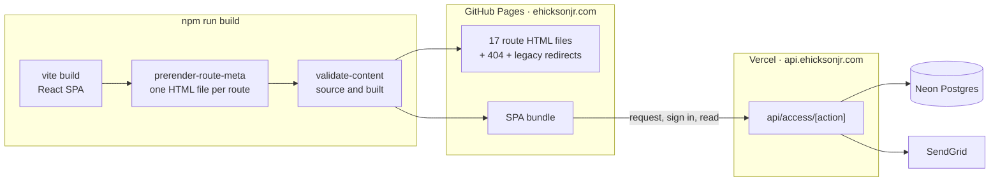

# 2. Architecture

[← Overview](01-overview.md) · Next: [Content governance →](03-content-governance.md)

## A single-page app that crawlers can read

The site is a React SPA on GitHub Pages, which only serves files.

After `vite build`, `scripts/prerender-route-meta.ts` writes one HTML file per canonical route. Each file carries that page's title, description, canonical URL, Open Graph and Twitter tags, and JSON-LD in the raw HTML, so link previews and crawlers see the right metadata without running JavaScript.

The files are named `about.html`, not `about/index.html`, because GitHub Pages serves `<path>.html` at `/<path>` with a 200, while `index.html` in a folder redirects to a trailing slash.

All of that metadata comes from `client/src/data/routeMeta/`, the same entries each page passes to its `<SEO>` component. A Vitest test fails if a route in `App.tsx` has no metadata entry.

## Case studies

Each case study is a bespoke page (`client/src/pages/<project>.tsx`) with:
- its own content file (`client/src/data/<project>.ts`)
- a scoped stylesheet in that project's own brand
- a generated media record
- capture and asset scripts
- a record in `docs/<PROJECT>-CASE-STUDY.md` listing every claim, its source and its state (verified, computed or known gap)

Gundam Forge and DojoNet share markup through a small case-study kit.

## One Express app, several deploy targets

`server/app.ts` builds one Express app. The production site doesn't need a server, but the same app runs:
- in development (with Vite middleware)
- on Netlify, through `serverless-http`
- on Railway or Replit (`build.sh`)

`server/vercel.ts` is a separate entry point that never imports Vite, even dynamically. Vercel's bundler traces every import and would otherwise ship development tooling into the function and blow its size limit.

## The access API

The WithYou engineering notes have a public overview and a locked section. The locked content lives only in `server/access/content.ts` and is never in the client bundle or the prerendered HTML.

One handler (`server/access/handler.ts`) runs as a Vercel function and inside the Express dev server. It handles requesting access, approving or denying it, signing in, reading the content and signing out:
- scrypt password hashes
- HMAC-signed approval links and sessions
- an HttpOnly cookie
- lockout after five failed sign-ins
- CORS limited to the site

Full design and setup: [`docs/ACCESS-GATE.md`](../ACCESS-GATE.md).
